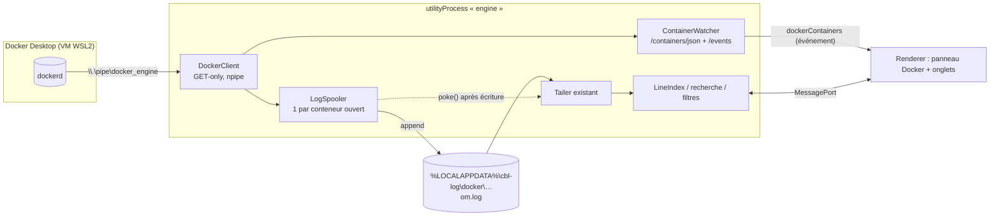

# cbl-log — Analyse technique : lire les logs des conteneurs Docker Desktop

> Statut : **analyse, à valider** — compagnon du [dossier d'architecture](./architecture.md).
> Objectif : depuis cbl-log, lister les conteneurs qui tournent dans Docker Desktop et ouvrir leurs logs
> (stdout/stderr) dans un onglet, en suivi temps réel, avec toutes les fonctions existantes (recherche,
> filtres, niveaux, surlignage, repli des stack traces). Le modèle visé est celui de **Dozzle**.

## 1. Résumé

| Question | Réponse courte |
|---|---|
| Une appli externe peut-elle parler à Docker Desktop ? | **Oui, sans rien configurer.** Docker Desktop expose l'API du démon sur le *named pipe* Windows `\\.\pipe\docker_engine`, accessible à tout utilisateur du groupe `docker-users` (ajouté par l'installeur). C'est exactement ce qu'utilise la CLI `docker.exe`. |
| Différence avec Dozzle ? | Dozzle est un serveur Go **dans un conteneur** à qui on monte `/var/run/docker.sock`. cbl-log fait la même chose **depuis Windows** via le named pipe. Même API HTTP, seul le transport change. |
| Où est la vraie difficulté ? | Pas dans la connexion, mais dans le **moteur** : tout cbl-log (index creux, lecture positionnelle, tailer, recherche, filtres) suppose une `Source` **fichier à accès aléatoire**. Docker fournit un **flux** HTTP. |
| Solution proposée | Un **spool** : le flux du conteneur est recopié en continu dans un fichier local (`%LOCALAPPDATA%\cbl-log\docker\…\<conteneur>.log`) que le moteur ouvre comme n'importe quel log. **Zéro changement** dans l'index, le tailer, la recherche et les filtres. |
| Dépendances | Aucune : client HTTP minimal maison sur `node:http` (`socketPath` accepte un named pipe). Pas de `dockerode`. |
| Effort estimé | **~8 à 11 jours**, découpés en 4 lots livrables séparément (§ 9). |

## 2. Ce que fait Dozzle, et ce qu'on reprend

Dozzle : `docker run -v /var/run/docker.sock:/var/run/docker.sock amir20/dozzle` → interface web.

| Fonction Dozzle | API Docker utilisée | Reprise dans cbl-log |
|---|---|---|
| Liste des conteneurs, état, groupement par projet compose | `GET /containers/json?all=1` + labels `com.docker.compose.project` / `.service` | ✅ panneau « Docker » |
| Liste mise à jour en direct | `GET /events?filters={"type":["container"]}` (flux) | ✅ |
| Logs en direct | `GET /containers/{id}/logs?follow=1&stdout=1&stderr=1&timestamps=1&tail=N` | ✅ → spool |
| Historique à la demande | `since` / `until` | ✅ chargement initial + reprise |
| Vue fusionnée de plusieurs conteneurs | — (côté UI) | ✅ via l'onglet « Tout » (§ 4.6 de l'archi) quand il existera |
| Stats CPU/mémoire, shell, actions start/stop | `/stats`, `/exec`, `POST /start`… | ❌ hors périmètre (cbl-log reste **lecture seule**) |

## 3. Connexion au démon Docker

### 3.1 Transport

Node sait faire du HTTP sur un named pipe Windows nativement :

```ts
import { request } from "node:http";

request({ socketPath: "\\\\.\\pipe\\docker_engine", path: "/v1.43/containers/json?all=1", method: "GET" }, (res) => { … });
```

Le même code marche avec un socket Unix (`/var/run/docker.sock`) ou en TCP (`host`/`port`) : le client est
portable même si cbl-log ne cible que Windows.

### 3.2 Résolution de l'endpoint (même ordre que la CLI `docker`)

1. Réglage explicite dans `settings.json` (`docker.host`), s'il existe.
2. Variable d'environnement `DOCKER_HOST` (`npipe:////./pipe/docker_engine`, `tcp://…`, `ssh://…`).
3. Contexte Docker courant : `%USERPROFILE%\.docker\config.json` → `currentContext`, puis
   `%USERPROFILE%\.docker\contexts\meta\<sha256(nom)>\meta.json` → `Endpoints.docker.Host`.
4. Défaut : `npipe:////./pipe/docker_engine`.

Docker Desktop crée aussi `\\.\pipe\dockerDesktopLinuxEngine` (contexte `desktop-linux`) : couvert par
l'étape 3. En mode « Windows containers », `docker_engine` pointe sur le moteur Windows : rien à changer.

### 3.3 Version d'API

`GET /version` au démarrage → `ApiVersion` du démon. On appelle ensuite `/v{min(ApiVersion, MAX_CLIENT)}/…`
avec une version minimale supportée (proposition : **1.41**, Docker 20.10, 2020). En dessous : message clair.

### 3.4 États et erreurs

| Situation | Symptôme | Comportement |
|---|---|---|
| Docker Desktop pas lancé | `ENOENT` sur le pipe | Panneau « Docker indisponible », nouvel essai toutes les 5 s (backoff jusqu'à 30 s) ; les onglets ouverts passent en `waiting` |
| Utilisateur hors `docker-users` | `EACCES` / `EPERM` | Message : « ajoutez votre compte au groupe docker-users puis reconnectez-vous » |
| Docker Desktop redémarre | flux coupés, `events` coupé | Reconnexion auto, reprise des logs par `since` (§ 5.3) sans doublon |
| Démon trop ancien | `ApiVersion` < 1.41 | Message, fonction désactivée |

### 3.5 Sécurité : **lecture seule imposée par le client**

L'accès à l'API Docker équivaut à un accès administrateur sur la VM. Le client maison n'expose **que des
`GET`** sur une liste blanche de routes (`/version`, `/containers/json`, `/containers/{id}/json`,
`/containers/{id}/logs`, `/events`). C'est l'argument principal pour **ne pas** prendre `dockerode`
(qui expose toute l'API, et tire `ssh2` avec une dépendance native optionnelle, contraire à
« aucune dépendance native » du § 2.3 de l'archi).

## 4. Le problème de fond : un flux face à un moteur « fichier »

Le moteur est construit sur cette interface (`packages/engine/src/source/source.ts`) :

```ts
interface Source {
  size(): Promise<number>;
  readAt(offset: number, length: number): Promise<Buffer>;   // lecture positionnelle
  identity(): Promise<SourceIdentity>;                       // ino/dev → détection du rolling
  close(): Promise<void>;
}
```

et le `Tailer` (`packages/engine/src/tail/tailer.ts`) est lié à `FileSource` : il fait des `stat`, compare des
identités, relit des ancres de 4 Ko, gère rename/truncate. Un flux HTTP n'a ni taille, ni offset, ni
relecture possible.

### 4.1 Options

| Option | Principe | Pour | Contre | Verdict |
|---|---|---|---|---|
| **A. Spool fichier** | Le flux est écrit en append dans un fichier local ; le moteur ouvre ce fichier comme un log normal | Réutilise **100 %** du moteur (index, tailer, recherche, filtres, formats, repli, rolling) ; mémoire constante ; marche pour des Go de logs | Écriture disque (négligeable : séquentielle) ; un dossier à nettoyer | ✅ **retenu** |
| B. `MemorySource` | Buffer qui grossit en RAM, implémente `Source` | Pas de disque | Tailer à réécrire (il dépend de `FileSource`) ; RAM proportionnelle aux logs → contraire à NF-02 | ❌ |
| C. Lire le fichier `json-file` du démon | `/var/lib/docker/containers/<id>/<id>-json.log` dans la VM | Pas de copie | Inaccessible proprement depuis Windows (VM `docker-desktop`, root, chemin qui change selon les versions de Docker Desktop) ; JSON par ligne à décoder ; faux si le driver est `local` | ❌ |
| D. `docker logs -f` en sous-processus (F-10) | Spawn de la CLI, stdout → spool | Trivial | Dépend de `docker.exe` dans le PATH ; un processus par conteneur ; pas de liste/événements ; stdout/stderr mélangés sans marquage | ⚠️ secours éventuel, pas la cible |

### 4.2 Pourquoi le spool est la bonne abstraction

Le spool transforme le problème « flux » en problème « fichier qui grossit », que cbl-log sait déjà
parfaitement traiter. Mieux : les cas Docker « bizarres » tombent sur des mécanismes **déjà testés** du
tailer :

| Événement Docker | Ce que fait le spool | Ce que voit le tailer (existant) |
|---|---|---|
| Nouvelles lignes | append | `rows` |
| Conteneur arrêté | ferme le flux, garde le fichier | rien (fichier stable) + état `stopped` |
| Conteneur redémarré (même id) | rouvre le flux avec `since`, continue en append | `rows` |
| Conteneur **recréé** (`compose up` → nouvel id, même nom) | renomme le spool en `<nom>.<ancien-id>.log`, crée un nouveau `<nom>.log` | **rolling rename + create** → séparateur, ancien segment conservé |
| Spool > plafond (ex. 256 Mo) | rename + create | rolling, au plus `maxRetainedSegments` segments gardés |

## 5. Conception du module Docker (`packages/engine/src/docker/`)

Tout vit dans le **`utilityProcess` moteur** (Node pur, pas d'Electron) : testable avec vitest comme le
reste, et pas de nouveau saut IPC.



### 5.1 `DockerClient` (~250 lignes)

- `resolveEndpoint()` (§ 3.2), `version()`, `listContainers()`, `inspect(id)`, `events(signal)`,
  `logs(id, { since, tail, follow }, signal)` → `Readable`.
- Requêtes `GET` uniquement ; `AbortSignal` pour couper un flux à la fermeture d'onglet.
- **Démultiplexage** : si le conteneur n'a pas de TTY (`inspect().Config.Tty === false`, cas courant), le
  flux est multiplexé par trames de 8 octets d'en-tête : `[stream (1=stdout, 2=stderr), 0, 0, 0, taille
  uint32 BE]` puis la charge. Avec TTY, flux brut. Petit transform stream dédié, testé avec des trames
  coupées n'importe où.

### 5.2 `ContainerWatcher`

- Au démarrage : `listContainers(all)` ; puis flux `/events` filtré sur `type=container`
  (`create`, `start`, `die`, `stop`, `destroy`, `rename`) pour tenir la liste à jour sans polling.
- Expose : id, nom, image, état, `StartedAt`, projet/service compose, driver de log
  (`HostConfig.LogConfig.Type`).
- Pousse un événement global `dockerContainers` (throttlé) vers les renderers abonnés.

### 5.3 `LogSpooler` (cœur de la fonctionnalité)

- **Clé d'un onglet = `contexte / projet compose / service`** (ou nom du conteneur hors compose), pas
  l'id : ainsi un `docker compose up` qui recrée le conteneur reste dans le même onglet (rolling).
- On demande **toujours `timestamps=1`** : chaque ligne arrive préfixée `2026-10-31T10:02:11.123456789Z `.
  Le préfixe est **retiré avant écriture** (le spool contient les lignes telles que l'appli les a écrites,
  donc l'auto-détection de format WebSphere/Spring/… marche à l'identique) et sert à :
  - **reprise sans doublon** : on mémorise le dernier timestamp écrit (petit `state.json` à côté du spool) ;
    à la reconnexion, `since=<secondes.nanos>` puis on saute les lignes dont le timestamp ≤ dernier écrit ;
  - plus tard, la vue fusionnée (un fichier « sidecar » de timestamps par ligne, hors MVP).
- **Chargement initial** : comme Dozzle, seulement les **N dernières lignes** (`tail=N`, défaut 5 000,
  réglable). Remonter plus loin ne peut pas se faire en ajoutant des lignes **avant** le contenu du spool :
  les n° de ligne du moteur sont globaux et ne reculent jamais. On propose donc une action
  « Charger plus d'historique » (×10, ou tout) qui **reconstruit** le spool : `tail=N'` jusqu'au dernier
  timestamp écrit, puis le suivi reprend. La vue est réindexée (rapide : quelques Mo) et la position
  conservée via le timestamp de la ligne visible.
- **Écriture** : tampon + `FileHandle.write` en append, vidé toutes les ~50 ms ou à 64 Ko ; puis
  `tailer.poke()` (petit ajout : déclencher un `check()` immédiat au lieu d'attendre le tick de 250 ms).
- **Rotation** : plafond par conteneur (défaut 256 Mo) → rename + create (§ 4.2).
- **stderr** : MVP = mélangé à stdout dans l'ordre d'arrivée. Option ultérieure : marquer les lignes
  stderr (bitmap sidecar) pour un surlignage/filtre « stderr ».
- **Lignes partielles** : Docker coupe les lignes > 16 Ko en plusieurs messages sans `\n` intermédiaire ;
  écrites telles quelles, elles se recollent naturellement dans le fichier.
- **Nettoyage** : spool supprimé à la fermeture de l'onglet (option « conserver » pour garder
  l'historique d'un conteneur supprimé) ; purge des spools orphelins au démarrage.

### 5.4 Performances du spool

**Mesure** (bench Node jetable, sous Linux, implémentation naïve non optimisée) : démultiplexage
+ retrait du préfixe horodaté + écriture en append par paquets de 64 Ko, sur 2 M lignes WebSphere de
~150 o (343 Mo de flux) : **~0,5 M lignes/s, 80–100 Mo/s, sur un seul cœur**.

| Poste | Coût à 10 000 lignes/s (≈ 1,5 Mo/s, cas extrême NF-04) | Coût typique (quelques dizaines de lignes/s) |
|---|---|---|
| CPU démux + écriture (moteur) | **~2 % d'un cœur** | négligeable |
| Disque en écriture | 1,5 Mo/s séquentiels (un SSD en absorbe des centaines) | quelques Ko/s |
| Disque en lecture | ~0 : le tailer relit ce qui vient d'être écrit, servi par le cache du système (page cache Windows) | ~0 |
| Mémoire | constante : tampon d'écriture 64 Ko par conteneur + cache de blocs **global** existant (64 Mo) | idem |
| Latence ajoutée | ≤ 50 ms (vidage du tampon) + `poke()` immédiat du tailer ; sans `poke()`, +250 ms (tick de polling) | idem |
| Ouverture (`tail=5000`) | dockerd lit la fin du fichier `json-file` (~1 Mo), écriture + indexation : **< 0,3 s** au total | idem |
| Espace disque | ≤ plafond par conteneur (256 Mo) × segments gardés ; avec `tail=N` le spool démarre petit | quelques Mo |

À comparer : Dozzle fait exactement la même lecture côté démon ; l'indexation du spool est celle de
n'importe quel fichier (déjà mesurée : 1 Gio indexé et filtré en ~2,5 s). Le spool n'est donc **pas** le
goulot. Les deux vrais points à surveiller, hors cbl-log :

- **dockerd** décode le JSON de son fichier `json-file` pour chaque ligne servie : à 10 000 lignes/s, de
  l'ordre de quelques % de CPU dans la VM. C'est le même coût que `docker logs -f` ou Dozzle.
- **Antivirus (Defender)** : il analyse surtout à l'ouverture/fermeture de fichier. On garde donc le handle
  du spool **ouvert** pendant tout le suivi (pas d'open/close par écriture). Si une mesure sous Windows
  montre un surcoût, exclure `%LOCALAPPDATA%\cbl-log\docker\`.
- Usure SSD : seul un conteneur extrêmement bavard (1,5 Mo/s en continu ≈ 130 Go/jour) écrirait beaucoup ;
  dans ce cas Docker écrit déjà autant dans son propre `json-file`. Non bloquant.

À valider en recette sous Windows (lot 4) : le bench ci-dessus tourne sous Linux.

### 5.5 Drivers de log

L'API `logs` ne fonctionne qu'avec `json-file`, `local` et `journald`, ou avec le **dual logging**
(Docker ≥ 20.10, actif par défaut) pour les autres drivers. Avec `log-driver: none` : rien à lire →
conteneur grisé dans la liste avec l'explication.

## 6. Changements dans l'existant

| Zone | Changement | Taille |
|---|---|---|
| `shared/protocol.ts` | `OpenParams` : `path` **ou** `docker: { context, key }` ; `TabInfo.source` (`file` / `docker`) ; requêtes `dockerList`, `dockerSubscribe` ; événement global `dockerContainers` | petit |
| `shared/index.ts` (`TabEvent`) | état `stopped` / `waiting` en plus de `following`/`missing`/`error` ; `rolled.reason` : ajouter `recreated` (libellé de séparateur « conteneur recréé ») | petit |
| `engine/tail/tailer.ts` | `poke()` public (check immédiat) ; accepter un `rolled.reason` imposé pour le spool | petit |
| `engine/service/engine-service.ts` | `openTab` : si `docker`, démarrer le spooler puis ouvrir un `Tailer` sur le chemin du spool ; `close` arrête le flux | moyen |
| `engine/docker/*` | nouveau module (§ 5) | gros |
| Renderer | panneau latéral **Docker** (liste groupée par projet compose, pastille d'état, filtre texte, double-clic = ouvrir, multi-sélection) ; icône baleine + nom du service dans l'onglet ; barre d'état « Docker · running depuis 10:02 » | moyen |
| Session / récents | stocker l'URI `docker://<contexte>/<projet>/<service>` ; à la réouverture, se raccrocher au conteneur courant de ce service | petit |
| `settings.json` (`config.ts`, zod) | `docker: { enabled, host?, initialTail, spoolMaxMb, keepSpoolOnClose }` | petit |

Le format WebSphere, les règles de surlignage, les filtres de niveau, la recherche, `Ctrl+G`, le repli
des stack traces : **rien à toucher**.

## 7. Cas particulier : la source de référence WebSphere

**Validé** : sur le conteneur WebSphere de référence, tout (`SystemOut` compris) part déjà sur le stdout
du conteneur. L'API `logs` suffit donc, et le format `websphere-basic` s'applique tel quel au spool
(le préfixe horodaté de Docker est retiré avant écriture).

Pour mémoire, si un autre conteneur écrivait ses logs dans des fichiers internes, trois voies :

| Voie | Suivi temps réel | Lecture seule | Verdict |
|---|---|---|---|
| **Bind mount** vers un dossier Windows (déjà recommandé, § 4.1 de l'archi) | ✅ | ✅ | ✅ reste la voie principale |
| `GET /containers/{id}/archive?path=…` | ❌ (instantané tar) | ✅ | ⚠️ « ouvrir une copie » ponctuelle |
| `POST /exec` + `tail -n +0 -F <fichier>` → spool | ✅ | ❌ (crée un exec dans le conteneur) | ⚠️ option explicite, hors MVP |

Hors MVP. Plus tard, dans le panneau Docker, afficher pour chaque conteneur ses **montages**
(`inspect().Mounts`) et proposer « ouvrir les fichiers du bind mount » quand un montage contient des
`*.log` — ça relie les deux mondes sans casser la règle « lecture seule ».

## 8. Hors Docker Desktop local

- **Docker du NAS** (cf. `my-house`) : **reporté**. Le démon n'est joignable qu'en SSH sur le NAS (pas
  d'API exposée sur le réseau). Piste pour plus tard, sans rien ouvrir côté NAS : un contexte
  `ssh://user@nas`, le client passant par `docker -H ssh://… system dial-stdio` (la CLI ouvre la session
  SSH et relaie l'API sur stdin/stdout) — même client GET-only, transport différent, pas de `ssh2` embarqué.
  Prérequis à vérifier : clé SSH, et utilisateur NAS ayant accès au socket Docker.
- **Docker Engine dans une distro WSL sans Docker Desktop** : le socket Unix de WSL n'est pas joignable
  depuis Windows ; passer par un contexte TCP. Hors périmètre.

## 9. Découpage et estimation

| Lot | Contenu | Estimation | Livrable |
|---|---|---|---|
| **1. Client Docker** | Résolution d'endpoint (env, contextes), `/version`, liste, inspect, `/events`, `logs` + démultiplexeur, liste blanche GET ; tests vitest contre un faux démon (`http.createServer` écoutant sur un named pipe de test) | 2–3 j | API interne testée |
| **2. Spool + moteur** | `LogSpooler` (reprise `since`, dédoublonnage, rotation, recréation), `Tailer.poke()`, `openTab` docker, nouveaux états/événements ; tests : conteneur arrêté/redémarré/recréé, coupure démon, trames coupées | 2–3 j | onglet docker ouvrable via le protocole |
| **3. UI** | Panneau Docker, onglets, barre d'état, session/récents, réglages | 2–3 j | fonctionnalité utilisable |
| **4. Recette** | Docker Desktop arrêté puis lancé, `compose up` qui recrée, conteneur bavard (10 000 lignes/s, NF-04), 8 conteneurs suivis (NF-11), mesure CPU/latence du spool sous Windows avec Defender actif ; ajout à `docs/recette/` | 1–2 j | critères d'acceptation |

**Total : ~8 à 11 jours.** Le lot 1 + 2 sans UI permet déjà de valider l'approche avec un onglet ouvert
par URI.

## 10. Risques

| Risque | Parade |
|---|---|
| Conteneur très bavard → spool énorme | `tail=N` à l'ouverture, plafond + rotation (§ 5.4) |
| Doublons/trous à la reconnexion | `timestamps=1` + `since` + saut des timestamps ≤ dernier écrit ; test dédié |
| `since` moins précis que le timestamp des lignes | On repart légèrement avant le dernier timestamp ; le dédoublonnage par timestamp absorbe le recouvrement |
| Évolution des chemins/contextes Docker Desktop | On ne dépend que du pipe et des fichiers de contexte de la CLI (formats stables), jamais de l'intérieur de la VM |
| Sécurité (API Docker = admin) | Client GET-only à liste blanche ; aucune action sur les conteneurs |
| Fichiers de spool qui traînent | Purge au démarrage, dossier dédié sous `%LOCALAPPDATA%` (pas `%APPDATA%` : pas d'itinérance) |
| Antivirus qui scanne le spool en écriture continue | Écritures groupées (50 ms / 64 Ko) ; documenter l'exclusion du dossier si besoin |

## 11. Décisions à valider

1. **Spool fichier** plutôt qu'une source mémoire (réutilise tout le moteur).
2. **Client HTTP maison GET-only** sur named pipe, pas de `dockerode`.
3. Onglet rattaché au **service compose** (survit à la recréation du conteneur, séparateur « conteneur recréé »).
4. ✅ **stdout/stderr** uniquement (WebSphere y écrit déjà tout).
5. ✅ Chargement initial : **N dernières lignes** (défaut 5 000) + « Charger plus d'historique ».
6. ✅ Docker du NAS : **reporté** (accès SSH uniquement) ; piste `ssh://` + `dial-stdio` notée au § 8.
