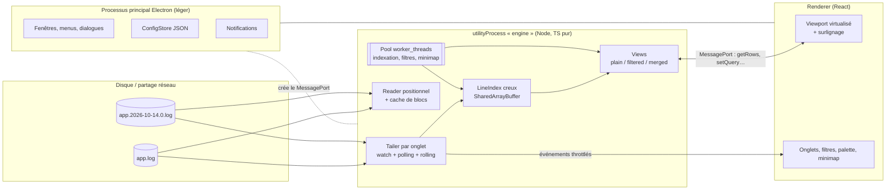
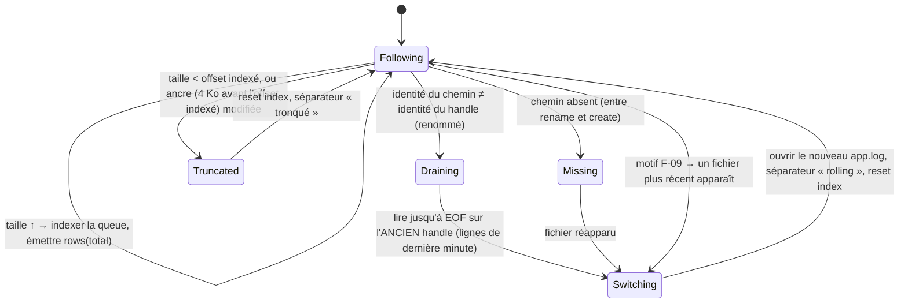

# cbl-log — Dossier d'architecture

> Statut : **v0.4 — validé pour démarrer M0** — compagnon du [cahier des charges fonctionnel](./cahier-des-charges-fonctionnel.md).
> Les identifiants `F-xx`, `T-xx`, `NF-xx`… renvoient aux exigences de ce dernier.
> v0.2 : passage de Tauri/Rust à **Electron + TypeScript** (langage maîtrisé), cible Windows seule,
> rolling au premier plan, pas de CLI/TUI.
> v0.3 : source de référence WebSphere dans Docker (truncate ou rename), volumes Docker Desktop,
> format WebSphere, onglet « Tout » (vue fusionnée), multi-logs (NF-11).

## 1. Principes directeurs

1. **Le fichier n'est jamais chargé en mémoire.** On garde un *index* compact des positions de lignes et
   on relit à la demande, par lecture positionnelle, uniquement ce qui est visible (F-02, NF-02).
2. **Le moteur est un module TypeScript pur** (Node, sans Electron) : testable et benchable seul.
3. **Le moteur pousse des compteurs, l'UI tire du contenu.** L'UI reçoit « il y a maintenant N lignes »
   et demande les lignes visibles ; un flux de 10 000 lignes/s ne traverse jamais l'IPC (NF-04).
4. **Le travail lourd ne tourne jamais sur un thread qui affiche** : indexation et filtres dans des
   `worker_threads`, hors du processus principal et du renderer.
5. **Lecture seule, sans gêner le rolling** de l'application qui écrit (T-04c, NF-08).
6. **Config = fichiers JSON** lisibles et versionnables (C-03).

## 2. Choix de la pile : TypeScript, et les performances ?

### 2.1 Réponse courte

**Les performances d'un visualiseur de logs dépendent de l'architecture bien plus que du langage.**
Les trois opérations critiques sont faites, en Node, par du code natif (C/C++) :

| Opération                          | En Node / Electron                                  | Écart vs Rust          |
|------------------------------------|-----------------------------------------------------|------------------------|
| Lire un bloc à un offset           | `fs.read(fd, buf, 0, len, position)` → libuv → `ReadFile` | aucun (c'est le disque qui limite) |
| Trouver les fins de ligne          | `Buffer.indexOf(0x0a)` → `memchr` natif, plusieurs Go/s | faible                 |
| Afficher 10 000 lignes/s           | Seules ~60 lignes visibles sont rendues, coalescé à 60 fps | identique (même WebView/Chromium) |
| Regex sur tout le fichier (filtre) | V8 Irregexp (compilé en code machine) + décodage UTF-8 | **2 à 4× plus lent**   |
| Mémoire au repos                   | Socle Chromium + Node                                | **~150 Mo de plus**    |

Ce qui faisait la différence dans la version Rust (index creux, lecture positionnelle, modèle pull,
coalescence) se transpose tel quel. Le seul vrai coût est le **filtre plein fichier sur de très gros
logs** (un filtre regex sur 10 Go passe de quelques secondes à ~10-20 s), compensé par : résultats
affichés au fil de l'eau, parallélisation sur plusieurs workers, annulation à chaque frappe. Pour des
fichiers de quelques centaines de Mo (cas courant avec du rolling), la différence est imperceptible.

Bonus inattendu côté Windows : **libuv ouvre les fichiers avec `FILE_SHARE_READ | FILE_SHARE_WRITE |
FILE_SHARE_DELETE`**. Autrement dit, Node ne bloque pas le renommage de `app.log` par Logback — le point
le plus sensible du rolling (T-04c) est réglé par défaut.

### 2.2 Options comparées

| Option                                   | Pour                                                                 | Contre                                                     | Verdict |
|------------------------------------------|----------------------------------------------------------------------|------------------------------------------------------------|---------|
| **Electron + TypeScript + React**        | Langage maîtrisé (ai-env-manager, showcase…) ; React connu ; écosystème riche ; partage de fichiers Windows OK par défaut | ~150 Mo de RAM de socle ; installeur ~90 Mo ; filtres plein fichier 2-4× plus lents | ✅ |
| Java 21 + JavaFX                         | Java/Spring maîtrisé ; NIO performant (`FileChannel`, partage delete OK) | UI JavaFX bien moins agréable que React pour thèmes/minimap/palette ; packaging `jpackage` plus lourd ; `java.io.FileInputStream` verrouille le rolling (piège) | ⚠️ alternative crédible |
| Tauri 2 (Rust + React)                   | Le plus léger/rapide                                                 | Le cœur doit être écrit en Rust                              | ❌ (langage non maîtrisé) |
| C# / WPF ou WinUI                        | Natif Windows, très performant                                       | Nouvelle stack à apprendre                                   | ❌ |

### 2.3 Briques principales

| Rôle                            | Choix                                                                |
|---------------------------------|----------------------------------------------------------------------|
| Coquille appli                  | Electron (dernière LTS), `contextIsolation`, `sandbox`, pas de `nodeIntegration` |
| Build                           | `electron-vite` (main + preload + renderer en TS, rechargement à chaud) |
| UI                              | React 18 + TypeScript, Zustand (état), liste virtualisée maison      |
| Fins de ligne / lecture         | `Buffer.indexOf`, `fs.promises.FileHandle.read` (positionnel)        |
| Parallélisme                    | `worker_threads` (pool de N = cœurs − 1), `SharedArrayBuffer` pour l'index |
| Encodages                       | `TextDecoder` (utf-8, utf-16le/be, windows-1252, iso-8859-1)         |
| Regex                           | `RegExp` JS (flag `d` pour les positions de fragments)               |
| Surveillance FS                 | `fs.watch` sur le **dossier** (ReadDirectoryChangesW) + polling `fs.stat` |
| Archives `.gz` (T-08)           | `zlib.createGunzip` (natif)                                          |
| Notifications (B-04)            | `Notification` d'Electron (toasts Windows)                           |
| Tests                           | `vitest` (moteur), Playwright-Electron pour quelques tests bout en bout |
| Packaging                       | `electron-builder` → installeur NSIS + `.exe` portable               |

Aucune dépendance native à compiler : pas de Visual Studio Build Tools nécessaire.

## 3. Vue d'ensemble



- **Pourquoi un `utilityProcess`** : le processus principal Electron gère les fenêtres ; s'il est
  occupé, toute l'appli gèle. Le moteur tourne donc dans un processus Node dédié, et le renderer lui
  parle **directement** via un `MessagePort` (créé par le main au démarrage), sans relais.
- Le renderer n'a aucun accès Node ; le `preload` expose une API typée minimale via `contextBridge`.

## 4. Le moteur (`packages/engine`)

### 4.1 Lecture

- Interface `Source` : `size()`, `readAt(offset, length)`, `identity()`, `close()` ; `FileSource` en P0,
  `GzSource` en P1 (archives du rolling), `CommandSource`/`SshSource` éventuellement plus tard.
- Lectures positionnelles par blocs de 64 Ko, cache LRU de blocs **global à toutes les sources** (64 Mo).
- **Pas de lecture de tout le fichier** ni de `readFile` / `createReadStream` sur la vue courante.
- ⚠️ Partage Windows : vérifié par un test d'intégration Windows (un process garde le fichier ouvert
  pendant qu'un autre le renomme/supprime) pour se protéger d'une régression de libuv.

**Lire un log écrit par un conteneur Docker (Docker Desktop / WSL2)** :

| Montage                                        | Chemin lu par cbl-log           | Événements FS | Verdict |
|------------------------------------------------|---------------------------------|---------------|---------|
| **Bind mount** `-v C:\logs\srv1:/logs`          | `C:\logs\srv1\SystemOut.log`    | oui (NTFS)    | ✅ recommandé |
| Volume nommé (vit dans la VM Linux)            | `\\wsl.localhost\docker-desktop…\` (chemin variable selon la version) | non | ⚠️ polling seul, chemin instable |
| Docker sur une autre machine (NAS, serveur)    | partage SMB `\\nas\logs\…`      | peu fiables   | ✅ polling 1 s |

Côté Linux, un rename ou un truncate fait par WebSphere n'est jamais bloqué par un handle ouvert
côté Windows (bind mount : le partage « delete » de libuv suffit ; volume/SMB : sémantique Linux).

### 4.2 Index de lignes creux

10 Go à ~150 o/ligne ≈ 70 M lignes ; un offset par ligne coûterait 560 Mo. On stocke **un point de
contrôle toutes les K = 64 lignes** dans un `Float64Array` (offsets exacts jusqu'à 2⁵³) ≈ 9 Mo,
alloué dans un `SharedArrayBuffer` extensible pour être lu par les workers sans copie.

- `offsetOf(line)` = `checkpoints[line / 64]` puis ≤ 63 `indexOf(0x0a)` sur un bloc (~10 Ko lu).
- Indexation initiale : un worker lit par blocs de 1 Mo et accumule les fins de ligne ; progression
  publiée toutes les ~100 ms.
- **La fin d'abord (F-03)** : `readTail` (lecture à rebours depuis EOF des ~500 dernières lignes) existe dans
  le moteur mais n'est pas branché. À l'ouverture, `open` répond une fois l'indexation terminée ; l'UI
  affiche un loader avec le pourcentage (événements `indexing` poussés sous l'`openId` fourni par le
  renderer). L'affichage immédiat de la fin (#406) est reporté : l'important est le suivi/rolling après le
  chargement initial.
- UTF-16 : recherche de `0x0a 0x00` aligné sur 2 octets. Lignes très longues : affichage plafonné à 64 Ko.

### 4.3 Suivi et **rolling**

Les serveurs et librairies de log roulent de trois façons :

| Stratégie                         | Librairies                                    | Ce que voit cbl-log                                |
|-----------------------------------|-----------------------------------------------|----------------------------------------------------|
| **Rename + create** (la plus courante) | **WebSphere traditional** (`SystemOut_26.10.14_10.02.11.log`), **Liberty** (`messages_26.10.14_10.02.11.0.log`, `maxFileSize`/`maxFiles`), Logback, Log4j2 | `SystemOut.log` renommé, nouveau `SystemOut.log` créé |
| **Nom daté, pas de renommage**    | Serilog (`app20261014.log`), Log4j2 `%d` dans `fileName` | Un nouveau fichier apparaît dans le dossier ; l'ancien ne bouge plus |
| **Truncate** (avec ou sans copie) | `logrotate copytruncate` dans le conteneur, scripts maison — **le cas observé** : même nom, archives créées à côté | Même fichier, taille qui retombe à ~0 |



Points clés :

- **Identité** : `fs.stat(path).ino` (sous Windows, libuv y met l'index de fichier NTFS) comparé au
  `handle.stat().ino`. Ça distingue « même fichier qui grandit » de « nouveau fichier au même nom ».
- **Aucune ligne perdue (T-04b)** : on garde le handle ouvert sur l'ancien fichier (renommé, mais lisible
  grâce au partage delete) et on le vide jusqu'à EOF *avant* de basculer.
- **Déclencheurs** : `fs.watch` sur le **dossier** (un watch sur le fichier lui-même suit le fichier
  renommé et rate la création) + **polling `stat`** toujours actif en filet (250 ms local, 1 s sur un
  chemin UNC `\\nas\…` ou `\\wsl.localhost\…`, où les événements sont peu fiables — F-07). Les événements ne sont qu'un indice,
  la vérité vient du `stat`.
- **Truncate qui regrossit vite (critère 3b)** : un fichier vidé peut avoir regrossi au-delà de l'ancienne
  taille avant le contrôle suivant ; comparer les tailles ne suffit pas. On garde une **ancre** = empreinte
  des 4 Ko qui précèdent le dernier offset indexé ; à chaque contrôle on relit ces 4 Ko (une petite lecture
  par fichier et par tick) : différents → troncature. WebSphere réécrit en plus un en-tête daté en tête de
  fichier, ce qui fait aussi changer l'empreinte des premiers octets (second indice).
- **Perte au truncate** : les lignes écrites entre notre dernière lecture et la troncature sont perdues
  (≤ un intervalle de polling, d'où 250 ms). Exception : en *copytruncate*, l'archive copiée contient ces
  octets → si une archive apparaît dont la taille ≥ notre offset, on y relit `[offset, fin]` pour **récupérer**
  les lignes manquantes avant le séparateur.
- **Modèle de lignes (implémenté : `Tailer`, `packages/engine/src/tail/`)** : une liste de **segments**, un par fichier physique suivi (`{id, path, startRow, rowCount, startedBy, readable}`). Les numéros de ligne sont **globaux et ne décroissent jamais** : un rolling n’efface rien, l’UI dessine le séparateur (T-04d) à `startRow` de chaque segment d’id > 0. `rolled.at` = `startRow` du nouveau segment. Rename : l’ancien handle reste ouvert (lisible, au plus `maxRetainedSegments`, 3 par défaut). Copytruncate : l’archive retrouvée (taille ≥ offset, mêmes 4 Ko d’ancre) devient la source du segment précédent, qui rattrape `[offset, fin]` (événement `rows`, puis `rolled`). Truncate sans archive : segment `readable: false`, ses lignes restent comptées. L’ancre est prise avant l’offset **scanné** (là où l’indexation reprend).
- **Coalescence** : au plus un événement `rows` par ~50 ms vers l'UI, quel que soit le débit.
- Dernière ligne sans `\n` tenue « ouverte » et ré-émise si elle grandit.
- **Archives (T-08)** : à partir du motif d'archive (déduit, ou déclaré dans le profil :
  `app.%d{yyyy-MM-dd}.%i.log(.gz)?`), on liste les fichiers précédents, triés par date/index.

### 4.4 Parseurs de format et records

Format déclaratif en JSON (C-04), regex à groupes nommés :

```json
{
  "id": "spring-boot",
  "detect": "^\\d{4}-\\d{2}-\\d{2}[ T]\\d{2}:\\d{2}:\\d{2}",
  "line": "^(?<ts>\\S+ \\S+)\\s+(?<level>[A-Z]+)\\s+\\d+\\s+---\\s+\\[(?<thread>[^\\]]+)\\]\\s+(?<logger>\\S+)\\s*:\\s(?<msg>.*)$",
  "timestamp": "yyyy-MM-dd HH:mm:ss.SSS",
  "levels": { "ERROR": "error", "WARN": "warn", "INFO": "info", "DEBUG": "debug", "TRACE": "trace" },
  "continuation": "not-line"
}
```

- Auto-détection sur les 100 premières lignes ; sinon format « brut ».
- `continuation: not-line` → les lignes qui ne matchent pas rejoignent le record précédent (stack traces, A-08).
  Index de records construit dans la même passe que l'index de lignes.
- Formats fournis : **WebSphere traditional, WebSphere Liberty, Liberty JSON** (P0), Spring Boot/Logback,
  Log4j2, JSON lines.

Format WebSphere `websphere-basic` (implémenté dans `packages/shared/src/formats.ts`, validé sur un `SystemOut.log` réel de WebSphere 9.0.5 : locale `M/d/yy`, fuseau `UTC`) — traditional `SystemOut.log` et Liberty `messages.log` partagent la même mise en page
« basic » : `[10/14/26 10:02:11:204 CEST] 0000004a SystemOut     O Hello`) :

```json
{
  "id": "websphere-basic",
  "detect": "^\\[\\d{1,2}/\\d{1,2}/\\d{2} \\d{1,2}:\\d{2}:\\d{2}:\\d{3} \\S+\\] [0-9a-f]{8} ",
  "line": "^\\[(?<ts>[^\\]]+)\\] (?<thread>[0-9a-f]{8}) (?<logger>\\S+)\\s+(?<level>[A-Z]) (?<msg>.*)$",
  "timestamp": "M/d/yy H:mm:ss:SSS z",
  "levels": { "F": "fatal", "E": "error", "R": "error", "W": "warn", "A": "info", "I": "info",
              "O": "info", "C": "debug", "D": "debug", "1": "trace", "2": "trace", "3": "trace" },
  "continuation": "not-line"
}
```

- L'ordre jour/mois dépend de la **locale du serveur** (`M/d/yy` en en_US, `dd/MM/yy` en fr_FR) : réglable
  par profil, avec détection automatique quand un jour > 12 apparaît.
- Le fuseau est une abréviation (`CEST`, `UTC`) : table abréviation → décalage dans `settings.json`.
- **Le niveau n'est presque jamais dans la lettre WebSphere** : les lignes `SystemOut` sont toutes de type `O`.
  Le niveau réel est celui de la mise en page applicative qui suit (`user|canal|yyyyMMdd|heure|NIVEAU|logger|…`),
  avec les niveaux de `java.util.logging` (`SEVERE`, `WARNING`, `INFO`, `CONFIG`, `FINE`, `FINER`, `FINEST`) :
  le format les lit via `levelFallbacks` (la lettre `O` vaut `none`).
- Les lignes qui ne commencent pas par l'en-tête (tabulation + `at …`, `Caused by:`, `… N more`, SQL sur plusieurs lignes,
  ligne d'exception sans préfixe, bandeau d'environnement du début) sont des suites de l'enregistrement précédent.
- Les identifiants de messages IBM (`CWWKZ0001I`, `WSVR0605W`, `…E`) servent de niveau de secours et
  fournissent des règles de surlignage par défaut (suffixe `E` rouge, `W` orange).
- Liberty JSON (`WLP_LOGGING_MESSAGE_FORMAT=json`) : mapping `ibm_datetime`, `loglevel`, `module`, `message`.

### 4.5 Recherche, filtres, vues

- Requête = arbre `And/Or/Not` de prédicats `Regex`, `Text`, `Level ≥`, `Field = v`, `TimeRange`.
- Exécution : fichier découpé en tranches, réparties sur le pool de workers ; chaque worker lit,
  décode et teste ses lignes, renvoie les n° de lignes trouvés (`Uint32Array` transférée sans copie).
  Résultats publiés par lots (premiers résultats < 1 s), annulation par message + debounce 150 ms.
- Préfiltre rapide : pour un prédicat texte simple, `Buffer.indexOf` sur les octets bruts avant tout
  décodage — la majorité des lignes est écartée sans créer de chaîne JS.
- **Garde-fou regex** : `RegExp` JS peut « exploser » (backtracking). Chaque tranche a un budget de temps ;
  dépassé → le worker est tué et l'UI signale « regex trop coûteuse ».
- Lignes ajoutées en follow testées à la volée (S-04).
- **View** = ce que voit l'UI : `rows()` et `rowToLine(row)`. `PlainView`, `FilteredView` (tableau trié
  des lignes retenues + recherche dichotomique), `MergedView` (§ 4.6). Passer filtré ↔ complet en gardant
  la position (S-05) = conversion via le n° de ligne source.

**Filtre de lignes (implémenté en M2, #431).** Plus simple que l'arbre de requête ci-dessus, qui reste
la cible pour M4 :

- `LineFilter { levels?, include?, exclude? }` (`packages/shared/src/filter.ts`) : une ligne est retenue
  si son niveau est coché **et** qu'elle contient un texte `include` (s'il y en a) **et** aucun texte
  `exclude`. Les textes se testent **ligne à ligne**, comme la recherche (mêmes options : regex, casse, mot entier).
- Le niveau suit l'**enregistrement** : une ligne de suite (stack frame, SQL…) a le niveau de l'en-tête
  qui la précède ; les lignes sans niveau sont masquées dès que les niveaux sont restreints. Sans format
  reconnu, le niveau n'est pas filtrable.
- `FilterSession` (`packages/engine/src/filter`) est calquée sur `SearchSession` : mêmes tranches (16 Mio, aux
  checkpoints) sur le même pool (`SliceRun`), garde-fou regex compris. Chaque worker relit au plus 256 lignes
  avant sa tranche (4 checkpoints) pour connaître le niveau de l'enregistrement en cours, puis renvoie les
  n° de lignes retenues et leurs niveaux (`Uint32Array` + `Uint8Array`).
- La vue filtrée n'expose que ce dont l'ordre est sûr : les tranches terminées en tête, plus les résultats
  partiels de la première tranche inachevée. Les positions ne bougent donc jamais pendant le parcours.
- Temps réel : sur `rows`, la session filtre la suite du fichier ; sur `rolled`, elle repart de zéro.
- `getRows` accepte un `filterId` : `first`/`count` indexent alors les lignes retenues, dont le `lineNo`
  reste celui du fichier. Le fichier courant seul est filtré (les anciens segments ne sont pas lisibles).
- Mesuré sur 1 Gio (8,4 M lignes) : premiers résultats en ~0,25 s, filtre complet en ~2,5 s (NF-05).
- La bascule filtré ↔ complet garde la position (`filterLocate` : n° de ligne du fichier → position dans la
  vue filtrée) ; `Ctrl+G`, la navigation de recherche (les occurrences sur des lignes masquées sont sautées),
  « Effacer » et le séparateur de rolling s'appliquent à la vue filtrée (#432).
- **Repli des stack traces (#439)** : `foldContinuation` ajoute une condition au filtre. Les lignes de suite
  sont masquées et chaque en-tête retenu porte le nombre de lignes repliées (`Row.folded`). Le worker les
  compte, en lisant au-delà de la fin de sa tranche jusqu'au prochain en-tête ; si l'enregistrement va
  jusqu'au bout de ce qui est indexé, la session le relit au parcours suivant pour que son compte soit exact.
  Le double-clic (#432) déplie une stack trace en montrant le fichier complet autour d'elle.

### 4.6 Onglet « Tout » : vue fusionnée (M-01, P1)

Chaque fichier a son onglet ; l'onglet **« Tout »**, épinglé en premier, montre tous les fichiers ouverts
(ou une sélection) entrelacés par horodatage. Ce n'est **pas** une copie des lignes : c'est une `MergedView`
au-dessus des index des sources.

- **Index de fusion** : un `Uint8Array` « n° de source » par row fusionnée (1 octet ; 70 M rows ≈ 70 Mo
  pour 10 Go cumulés), plus un point de contrôle toutes les 64 rows contenant le compteur de records de
  chaque source. `rowToLine(r)` = point de contrôle + ≤ 63 pas → (source, n° de record) en O(1).
- **Construction** : fusion k-voies par `(timestamp, n° de source)`, chaque source gardant son ordre propre
  (comme `sort -m`). Les timestamps sont lus/parsés par les workers en flux et ne sont pas conservés.
- **Temps réel** : les records ajoutés sont insérés en fin si leur timestamp ≥ dernier ; une fenêtre de
  ré-ordonnancement (~2 s) absorbe les petits décalages entre conteneurs.
- **Rolling d'une source** : séparateur étiqueté dans la vue ; si la source est tronquée, ses anciennes
  rows sont retirées (passe linéaire sur le `Uint8Array`, quelques ms).
- **Affichage** : colonne étiquette (`srv1`, `srv2`…) + liseré de couleur par source ; cases pour masquer
  une source (= filtre `Field source`) ; « ouvrir dans l'onglet du fichier » via `rowToLine` (M-01c).
- Filtres, surlignage, recherche et alertes passent par les mêmes mécanismes (M-01d).
- Prérequis : chaque source a un format reconnu avec timestamp ; sinon elle est proposée mais grisée.

### 4.7 Alertes (B-04)

Règles `{ query, cooldownSec, sound }` évaluées sur les lignes **ajoutées** uniquement, dans le tailer ;
déclenchement → message au main → toast Windows + badge sur l'onglet.

## 5. Surlignage : dans le renderer

Le surlignage ne concerne que les ~100 lignes affichées : il est fait **dans le renderer**, avec les
mêmes `RegExp` que le moteur (même syntaxe partout, H-01). Les règles « fragment » utilisent le flag
`d` (`match.indices`) pour les positions. Coût négligeable, et changer une règle se voit immédiatement
sans aller-retour IPC. La minimap (A-05) est calculée par un worker du moteur (règle dominante par
tranche, ~2 000 cases).

## 6. API moteur ↔ renderer

Messages typés (types partagés dans `packages/shared`), sur le `MessagePort` :

| Requête                                   | Réponse / rôle                                       |
|-------------------------------------------|------------------------------------------------------|
| `open({ path \| pattern, encoding? })`    | `TabId`                                              |
| `close(tab)`                              |                                                      |
| `getRows(tab, first, count)`              | lignes décodées + n° source + infos record/repli + marqueurs de rolling |
| `setQuery(tab, query \| null)`            | `QueryId`                                            |
| `search(tab, query, fromRow, dir)`        | prochain résultat                                    |
| `goto(tab, { line } \| { ts })`           | n° de row                                            |
| `setFollow`, `setPaused`                  | T-02, T-06                                           |
| `listArchives(tab)`, `openArchive(path)`  | T-08                                                 |
| `export(tab, range, path)`                | B-03                                                 |

Événements poussés (throttlés ~50 ms) :

```ts
type TabEvent =
  | { type: "rows"; total: number; appended: number }
  | { type: "indexing"; progress: number; provisional: boolean }
  | { type: "rolled"; reason: "rename" | "truncate" | "new-file"; previous?: string; at: number }
  | { type: "state"; state: "following" | "missing" | "error"; message?: string }
  | { type: "query"; id: string; matches: number; done: boolean }
  | { type: "alert"; ruleId: string; line: number };
```

Le renderer ne demande que ce qu'il affiche : en follow, à chaque `rows`, il fait
`getRows(tab, total - visibles, visibles)`.

## 7. Renderer (React)

- **Viewport virtualisé maison** : hauteur de ligne fixe sans wrap → position = `row × h` ; seules ~2× les
  lignes visibles sont dans le DOM ; barre de défilement mise à l'échelle au-delà de ~33 M px.
- Wrap : hauteurs mesurées sur la fenêtre visible seulement ; défilement approximatif par ligne (assumé).
- Cache de pages (200 lignes, LRU) + préchargement de la page suivante.
- Composants : `TabBar`, `SplitLayout`, `FilterBar`, `LogViewport`, `RollingSeparator`, `Minimap`,
  `StatusBar`, `CommandPalette`, `RulesEditor`, `ProfilesDialog`, `ArchivesPanel`.
- Thèmes en variables CSS (clair/sombre/système, suit le thème Windows via `nativeTheme`).
- Plan B si le DOM ne suit pas : rendu du viewport en `<canvas>`, sans changer l'API.

## 8. Configuration et persistance

`%APPDATA%\cbl-log\` :

```
settings.json          # thème, police, polling, raccourcis…
session.json           # onglets, positions, follow, filtres (écrit à la fermeture + toutes les 30 s)
rules\<id>.json        # jeux de règles de surlignage
formats\<id>.json      # parseurs (en plus des formats intégrés)
profiles\<id>.json     # fichier/motif + motif d'archives + règles + format + filtres + alertes
bookmarks\<hash>.json  # signets par fichier
```

Chaque fichier porte `schemaVersion` (migrations au chargement), validé par un schéma (`zod`) ; dossier
surveillé → rechargement à chaud ; un fichier invalide est signalé et ignoré, jamais fatal.

## 9. Arborescence cible

```
cbl-log/
├── README.md
├── docs/
├── package.json               # workspaces npm
├── electron.vite.config.ts
├── electron-builder.yml
├── packages/
│   ├── shared/                # types des messages, schémas zod de la config
│   └── engine/                # TS pur Node : source, index, tailer/rolling, format, query, view, merge
│       ├── src/
│       ├── test/              # vitest : index, rolling (rename/create, truncate, nom daté), encodages
│       └── bench/             # générateur de gros logs + mesures NF-01..NF-05
└── app/
    ├── main/                  # processus principal : fenêtres, config, notifications, utilityProcess
    ├── preload/               # contextBridge
    └── renderer/              # React
```

## 10. Qualité, tests, livraison

Contrairement au reste du monorepo (« no tests »), **le moteur est testé** : c'est là que se cachent les
bugs subtils (rolling, offsets, encodages).

- Tests unitaires `vitest` : index creux (CRLF, dernière ligne ouverte, UTF-16), parseurs, requêtes.
- Tests d'intégration rolling : un écrivain simulé écrit en continu et roule par **rename + create**,
  **nom daté** et **truncate** ; vérif « aucune ligne perdue ni dupliquée » et « le rename de l'écrivain
  n'échoue jamais ».
- Truncate qui regrossit au-delà de l'ancienne taille entre deux ticks (critère 3b), et récupération depuis
  l'archive en copytruncate.
- Test bout en bout avec un conteneur **WebSphere Liberty** (`icr.io/appcafe/open-liberty`) dans un bind
  mount, `maxFileSize=1` (critère d'acceptation n°3).
- Vue fusionnée : ordre global, sources masquées, retrait d'une source tronquée.
- Bench : `npm run bench -- --size 10G` mesure ouverture, indexation, `getRows`, filtre.
- **CI GitHub Actions sur `windows-latest`** : `npm ci`, typecheck, `vitest`, build ; sur tag `cbl-log-v*`,
  `electron-builder` publie installeur + portable en release GitHub.
- Ajout à `.claude/skills/weekly-deps/scope.json` dès que le `package.json` existe (npm, déjà supporté).

## 11. Risques et parades

| Risque                                                      | Parade                                                                  |
|-------------------------------------------------------------|-------------------------------------------------------------------------|
| Filtre plein fichier lent sur très gros logs                | Workers parallèles, préfiltre `Buffer.indexOf`, résultats progressifs, annulation |
| Regex catastrophique (backtracking JS)                      | Budget de temps par tranche, worker tué, message clair                  |
| Rolling raté → lignes perdues                               | Vidage de l'ancien handle avant bascule + tests d'intégration dédiés    |
| Régression libuv sur le partage de fichiers Windows         | Test CI Windows dédié                                                   |
| `fs.watch` peu fiable sur partage réseau                    | Polling `stat` toujours actif, intervalle adaptatif                     |
| Mémoire de socle Electron                                   | Assumé (NF-02 revu à 400 Mo) ; un seul processus moteur pour tous les onglets |
| 8 fichiers en follow (NF-11)                                | Un seul ordonnanceur de polling pour toutes les sources (ticks décalés), cache de blocs **global** (64 Mo), pool de workers partagé |
| Volume Docker nommé (`\\wsl.localhost\…`) lent / sans événements | Recommander un **bind mount** vers un dossier Windows (`-v C:\logs\srv1:/opt/IBM/…/logs`) ; polling dans tous les cas |
| Locale/fuseau des timestamps WebSphere                      | Réglage par profil + détection, table de fuseaux configurable         |
| DOM trop lent en follow intensif                            | Modèle pull + coalescence ; plan B canvas                               |

## 12. Décisions à valider

1. **Electron + TypeScript + React** (alternative : Java + JavaFX si tu préfères rester sur Java).
2. Moteur dans un **`utilityProcess`** + `worker_threads`, renderer branché en `MessagePort`.
3. Index **creux K = 64** dans un `SharedArrayBuffer`, lecture positionnelle.
4. Surlignage **dans le renderer**, filtres/recherche **dans le moteur**.
5. Config en **JSON** validée par `zod`.
