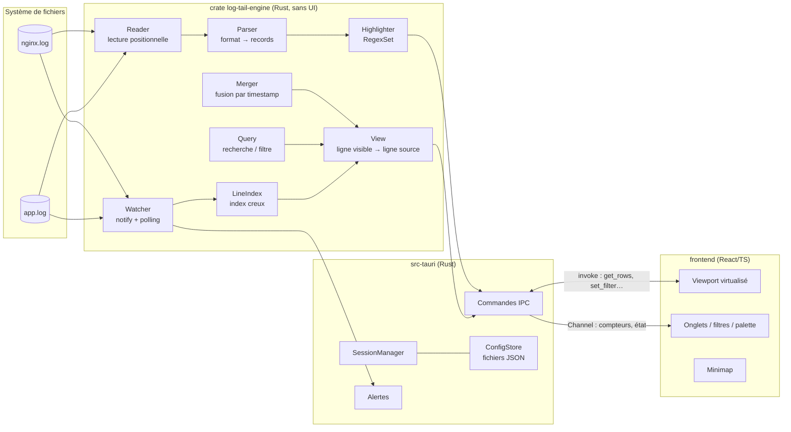
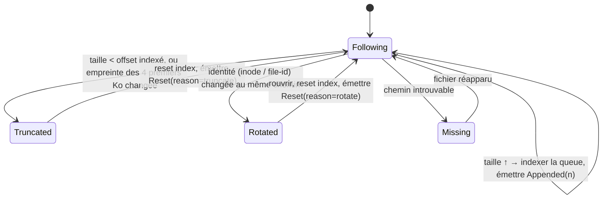

# log-tail — Dossier d'architecture

> Statut : **brouillon v0.1** — compagnon du [cahier des charges fonctionnel](./cahier-des-charges-fonctionnel.md).
> Les identifiants `F-xx`, `T-xx`, `NF-xx`… renvoient aux exigences de ce dernier.

## 1. Principes directeurs

1. **Le fichier n'est jamais chargé en mémoire.** On garde un *index* compact des positions de
   lignes et on relit à la demande, par lecture positionnelle, uniquement ce qui est visible (F-02, NF-02).
2. **Le moteur est une bibliothèque autonome**, sans dépendance à l'UI : testable, benchable, et
   réutilisable plus tard par une CLI/TUI (question ouverte n°5).
3. **Le backend pousse des compteurs, le frontend tire du contenu.** L'UI reçoit « il y a maintenant
   N lignes » et demande les lignes visibles ; un flux de 10 000 lignes/s ne traverse jamais l'IPC (NF-04).
4. **Un seul moteur regex** (crate Rust `regex`, temps linéaire, pas de backtracking catastrophique)
   pour surlignage, recherche, filtres, parseurs et alertes : même syntaxe partout.
5. **Lecture seule, sans verrou** sur les fichiers suivis (F-04, NF-08).
6. **Config = fichiers texte** lisibles et versionnables (C-03) ; la personnalisation passe par des
   fichiers, pas par du code.

## 2. Choix de la pile technique

**Retenu : [Tauri 2](https://tauri.app) — cœur en Rust + interface React/TypeScript (Vite).**

| Option                         | Pour                                                      | Contre                                                  | Verdict |
|--------------------------------|-----------------------------------------------------------|---------------------------------------------------------|---------|
| **Tauri 2 (Rust + React/TS)**  | Perf native pour l'I/O et les regex ; binaire ~10 Mo ; React déjà utilisé dans le monorepo (showcase, prono-core, spec-merger) ; UI riche facile (thèmes, minimap, palette) | Deux langages ; WebView variable selon l'OS | ✅ |
| Electron (Node + React)        | Un seul langage (TS), écosystème connu                    | 150 Mo+ de RAM/disque, Node moins adapté aux scans de Go | ❌ |
| GUI Rust native (egui, iced, Slint) | Un seul binaire Rust, rendu très rapide              | Mise en forme riche plus laborieuse, moins agréable à customiser | ⚠️ plan B si la WebView ne tient pas NF-04 |
| TUI (ratatui)                  | Ultra léger, marche en SSH                                | Pas de souris riche/minimap/split confortable ; ne remplace pas BareTail | ➕ éventuel 2ᵉ front sur le même moteur |
| Serveur local + navigateur     | Accessible à distance                                     | Lancement moins naturel, gestion de port/sécurité       | ❌ |

Briques principales :

| Rôle                         | Choix                                                                    |
|------------------------------|--------------------------------------------------------------------------|
| Recherche d'octets           | `memchr` (SIMD) pour trouver les fins de ligne                          |
| Regex                        | `regex` (+ `regex::bytes`, `RegexSet` pour évaluer N règles en une passe) |
| Événements FS                | `notify` (inotify / ReadDirectoryChangesW / FSEvents) + polling          |
| Identité de fichier          | `same-file` / `file-id` (inode+dev, ou index NTFS)                      |
| Encodages                    | `encoding_rs`                                                            |
| Parallélisme des scans       | `rayon` ; annulation par jeton (`Arc<AtomicBool>`)                       |
| Ensembles de lignes (filtres)| `roaring` (bitmaps compressés)                                           |
| Dates                        | `chrono` (+ formats strftime déclarés dans les parseurs)                 |
| Config                       | `serde` + `serde_json` ; schéma versionné                               |
| Notifications                | `tauri-plugin-notification`                                              |
| Frontend                     | React 18, TypeScript, Vite, Zustand (état), liste virtualisée maison    |

## 3. Vue d'ensemble



## 4. Le moteur (`log-tail-engine`)

### 4.1 Source et lecture

- Trait `Source` : `len()`, `read_at(offset, buf)`, `identity()`, `kind()` ; implémentation `FileSource`
  en P0, `GzSource` / `CommandSource` / `SshSource` plus tard (F-08, F-10, F-11) sans toucher au reste.
- **Pas de `mmap`** : un fichier qui rétrécit provoque un `SIGBUS` sous Unix, et sous Windows un mapping
  empêche la suppression/rotation par l'application qui écrit. On fait des lectures positionnelles
  (`pread` / `seek_read`) par blocs de 64 Ko, avec un petit cache LRU de blocs.
- **Windows** : ouverture avec `FILE_SHARE_READ | FILE_SHARE_WRITE | FILE_SHARE_DELETE`
  (`OpenOptionsExt::share_mode`) — c'est ce qui permet à l'appli surveillée de renommer ou supprimer
  le fichier pendant qu'on le lit (critère d'acceptation n°4). Le handle est rouvert si le fichier est remplacé.

### 4.2 Index de lignes creux

Un fichier de 10 Go à ~150 o/ligne ≈ 70 M de lignes. Stocker chaque offset (8 o) coûterait 560 Mo → on
stocke **un point de contrôle toutes les K = 64 lignes** : `checkpoints: Vec<u64>` ≈ 9 Mo.

- `offset_of(line)` = `checkpoints[line / K]` puis scan `memchr` de ≤ 63 fins de ligne (~10 Ko lus) — quelques µs.
- Les pages visibles sont lues en un seul `read_at` contigu.
- Indexation : scan séquentiel par gros blocs (1 Mo) avec `memchr` ; borne = débit disque (NF-03).
  Publication de la progression toutes les ~100 ms.
- **Affichage de la fin d'abord (F-03)** : à l'ouverture, on lit à rebours depuis EOF pour trouver les
  ~500 dernières lignes et on les affiche immédiatement, avec numéros « provisoires » (comptés depuis la
  fin). L'indexation avant tourne en tâche de fond ; à la fin, les numéros définitifs remplacent les provisoires.
- Encodages UTF-16 : la recherche de fins de ligne travaille sur des unités de 2 octets alignées ;
  le décodage (`encoding_rs`) n'est fait que sur les lignes affichées/scannées.
- Lignes très longues (F-06) : l'index les gère comme les autres ; seule la *lecture pour affichage* est
  plafonnée (ex. 64 Ko), avec un indicateur « tronqué ».

### 4.3 Suivi temps réel et rotation



- Les événements `notify` ne sont qu'un **déclencheur** ; la vérité vient d'un `stat` (taille, mtime,
  identité). Un **polling** (250 ms local, 1 s réseau, configurable) tourne toujours en filet de sécurité,
  indispensable sur SMB/NFS où les événements sont absents ou peu fiables (F-07).
- Les ajouts sont **coalescés** : au plus un message `Appended` par tranche de ~50 ms, quel que soit le débit.
- `copytruncate` est le cas piège (même inode, taille qui peut déjà avoir regrossi) : d'où l'empreinte
  des premiers octets en plus de la comparaison de taille.
- Une dernière ligne sans `\n` est tenue « ouverte » et ré-émise si elle grandit.

### 4.4 Parseurs de format et records

Un **format** est déclaratif (C-04) :

```json
{
  "id": "spring-boot",
  "detect": "^\\d{4}-\\d{2}-\\d{2}[ T]\\d{2}:\\d{2}:\\d{2}",
  "line": "^(?P<ts>\\S+ \\S+)\\s+(?P<level>[A-Z]+)\\s+\\d+\\s+---\\s+\\[(?P<thread>[^\\]]+)\\]\\s+(?P<logger>\\S+)\\s*:\\s(?P<msg>.*)$",
  "timestamp": "%Y-%m-%d %H:%M:%S%.3f",
  "levels": { "ERROR": "error", "WARN": "warn", "INFO": "info", "DEBUG": "debug", "TRACE": "trace" },
  "continuation": "not-line"
}
```

- `detect` sert à l'auto-détection sur les 100 premières lignes ; sinon format « brut ».
- `continuation: not-line` : toute ligne qui ne matche pas `line` est rattachée au record précédent
  → regroupement des stack traces (A-08). Un **index de records** (même structure creuse que l'index
  de lignes) est construit dans la même passe que l'indexation.
- Format `jsonl` spécial : champs mappés par chemin (`"ts": "$.timestamp"`) (A-09).
- Formats fournis : Spring Boot/Logback, nginx access/error, JSON lines, syslog. L'utilisateur en
  ajoute en déposant un fichier dans `formats/`.

### 4.5 Surlignage

- Les règles actives d'un onglet sont compilées en un `RegexSet` (savoir *quelles* règles matchent en
  une passe) + les `Regex` individuelles pour les règles « fragment » (positions exactes) (H-01, H-02).
- Calculé **côté Rust, uniquement pour les lignes demandées** par le viewport (≈ 100 lignes) : coût
  négligeable, et l'UI reçoit des segments déjà stylés.
- La minimap (A-05) utilise un scan de fond qui produit, par tranche de lignes, la règle dominante
  (histogramme réduit à ~2 000 cases).

### 4.6 Recherche, filtres, vues

- Une **requête** = arbre `And/Or/Not` de prédicats : `Regex`, `Text`, `Level ≥`, `Field = valeur`,
  `TimeRange` (S-02, S-03, S-08).
- Exécution : découpage du fichier en tranches, évaluation parallèle (`rayon`), résultat =
  **bitmap `roaring`** des numéros de lignes (ou de records) correspondants. Résultats publiés par lots
  dès qu'ils arrivent (NF-05), annulable à chaque frappe (jeton d'annulation + debounce 150 ms).
- Les lignes ajoutées en follow sont testées à la volée et ajoutées au bitmap (S-04).
- Une **View** est l'abstraction que voit l'UI : `rows() -> u64` et `row_to_line(row) -> LineRef`.
  - `PlainView` : identité.
  - `FilteredView` : rang dans le bitmap (`select`) — O(log n).
  - `ContextView` : bitmap élargi de ±N lignes (S-06).
  - `MergedView` : fusion de plusieurs sources (§ 4.7).
  Passer filtré ↔ complet en gardant la position (S-05) = convertir via `LineRef`.

### 4.7 Vue fusionnée multi-fichiers (M-01)

- Chaque source doit avoir un format avec `timestamp`. On construit un **index de fusion** : fusion
  k-voies des records triés par `(timestamp, source, n° de record)`, stocké sous forme compacte
  (`source: u8` + n° de record delta-encodé par blocs).
- Les logs ne sont pas toujours strictement ordonnés : on fusionne dans l'ordre d'apparition par source
  (pas de tri intra-source) — comportement prévisible, identique à `sort -m`.
- En follow, les nouveaux records sont insérés en fin si leur timestamp ≥ dernier ; sinon fenêtre de
  ré-ordonnancement de quelques secondes.

### 4.8 Alertes (B-04)

Règles `{ query, cooldownSec, sound }` évaluées sur les lignes *ajoutées* uniquement (pas sur
l'historique), dans le thread de suivi ; déclenchement → événement vers l'app, qui émet la notification
système et un badge sur l'onglet.

## 5. Application Tauri (`src-tauri`)

### 5.1 API IPC

Commandes (`invoke`, requête/réponse) :

| Commande                                  | Rôle                                                       |
|-------------------------------------------|------------------------------------------------------------|
| `open_source(spec) -> TabId`              | Ouvre fichier / motif / (plus tard) commande               |
| `close_tab(tab)`                          |                                                            |
| `get_rows(tab, first, count) -> RowsPage` | Contenu visible : texte décodé + segments de style + n° de ligne + record/replié |
| `set_rules(tab, ruleSetId \| rules)`      | Change le surlignage                                       |
| `set_query(tab, query?) -> QueryId`       | Applique / retire un filtre                               |
| `search(tab, query, from, dir) -> Hit?`   | Résultat suivant / précédent                              |
| `goto(tab, Line \| Timestamp) -> row`     | A-06, A-07                                                 |
| `set_follow(tab, bool)`, `set_paused`     | T-02, T-06                                                 |
| `export(tab, range, path)`                | B-03                                                       |
| `bookmarks_*`, `profiles_*`, `config_*`   | CRUD                                                       |

Événements poussés via un `tauri::ipc::Channel` **par onglet**, throttlés (~50 ms) :

```ts
type TabEvent =
  | { type: "rows"; total: number; appended: number }          // le front décide s'il redemande
  | { type: "indexing"; progress: number; provisional: boolean }
  | { type: "reset"; reason: "truncate" | "rotate" | "recreated" }
  | { type: "state"; state: "following" | "missing" | "error"; message?: string }
  | { type: "query"; id: string; matches: number; done: boolean }
  | { type: "alert"; ruleId: string; line: number };
```

Les types partagés Rust ↔ TS sont générés (`specta` / `ts-rs`) pour éviter la dérive.

### 5.2 Threads

- Un **thread de suivi** par source (watcher + indexation incrémentale).
- Un **pool rayon** partagé pour indexation initiale, requêtes et minimap (priorité : requête > minimap).
- Les commandes `get_rows` sont servies sur le runtime async de Tauri et ne font que des lectures courtes.
- État partagé : `Arc<RwLock<LineIndex>>` en append-only (lecteurs jamais bloqués longtemps).

### 5.3 Configuration et persistance (C-01 à C-04)

Répertoire de config de l'OS (`%APPDATA%\log-tail`, `~/.config/log-tail`, `~/Library/Application Support/log-tail`) :

```
settings.json          # thème, police, polling, raccourcis…
session.json           # onglets ouverts, positions, follow, filtres (écrit à la fermeture + toutes les 30 s)
rules/<id>.json        # jeux de règles de surlignage
formats/<id>.json      # parseurs (s'ajoutent aux formats intégrés)
profiles/<id>.json     # fichiers/motifs + règles + format + filtres + alertes
bookmarks/<hash>.json  # signets par fichier (hash du chemin absolu)
```

- Chaque fichier porte `"schemaVersion"` ; migrations au chargement.
- Le dossier est surveillé : éditer un fichier de règles à la main le recharge à chaud.
- Un fichier invalide est signalé (toast + chemin + erreur) et ignoré, jamais fatal.

## 6. Frontend (`frontend/`)

- **Viewport virtualisé maison** : hauteur de ligne fixe en mode sans wrap → position = `row × h`,
  seules ~2× les lignes visibles sont dans le DOM. La barre de défilement est calculée sur `total`
  (avec mise à l'échelle au-delà de la hauteur max d'un élément DOM, ~33 M px).
- Mode **wrap** : hauteurs mesurées pour la fenêtre visible seulement ; la barre de défilement reste
  basée sur le nombre de lignes (approximation assumée, comme dans les éditeurs de code).
- **Cache de pages** côté front (pages de 200 lignes, LRU) ; préchargement de la page suivante.
- Follow : à chaque événement `rows`, si follow actif → `get_rows(total - visible, visible)`.
- Composants : `TabBar`, `SplitLayout`, `FilterBar`, `LogViewport`, `Minimap`, `StatusBar`,
  `CommandPalette`, `RulesEditor`, `ProfilesDialog`.
- État global Zustand ; thèmes en variables CSS (clair/sombre/système).
- Plan B performance (si NF-04 non tenu) : rendu du viewport en `<canvas>` sans changer l'API.

## 7. Arborescence cible

```
log-tail/
├── README.md
├── docs/
│   ├── cahier-des-charges-fonctionnel.md
│   └── architecture.md
├── Cargo.toml                 # workspace
├── crates/
│   ├── engine/                # log-tail-engine : source, index, watch, format, highlight, query, view, merge
│   │   ├── src/
│   │   ├── tests/             # intégration : rotation, troncature, encodages, gros fichiers
│   │   └── benches/           # criterion : indexation, get_rows, filtre
│   └── cli/                   # log-tail-cli : génération de logs de test + bench ; TUI éventuelle
├── src-tauri/                 # app : commandes IPC, session, config, alertes, notifications
│   ├── src/
│   └── tauri.conf.json
└── frontend/                  # React + TS + Vite
    ├── package.json
    └── src/
```

## 8. Qualité, tests, livraison

Contrairement aux autres outils du monorepo (« no tests »), le moteur **doit** être testé : c'est là
que se jouent les bugs subtils (rotation, encodages, offsets).

- **Tests unitaires** : index creux (offsets, dernière ligne ouverte, CRLF, UTF-16), parseurs, requêtes.
- **Tests d'intégration** : un écrivain simulé (thread) + scénarios `logrotate` create / copytruncate /
  suppression-recréation / troncature ; vérif « aucune ligne perdue ni dupliquée ».
- **Tests de propriétés** (`proptest`) : `offset_of(line)` cohérent avec un découpage naïf.
- **Benchs** (`criterion`) sur fichiers générés par `log-tail-cli gen --size 10G` : suivent NF-01 à NF-05.
- **CI GitHub Actions** : `cargo test` + `clippy` sur Ubuntu **et Windows** (le partage de fichiers
  Windows ne se teste que sous Windows), `npm run build` du front ; sur tag `log-tail-v*`, build
  `tauri build` → installeurs `.msi` / `.AppImage` / `.dmg` en release GitHub.
- **Dépendances** : à ajouter à `.claude/skills/weekly-deps/scope.json` une fois le code présent
  (le front est en npm ; le support `cargo` devra être ajouté à la routine).

## 9. Risques et parades

| Risque                                                      | Parade                                                               |
|-------------------------------------------------------------|----------------------------------------------------------------------|
| WebView trop lente à 10 000 lignes/s                        | Modèle pull + coalescence ; plan B rendu canvas ; plan C GUI Rust native |
| Rotation `copytruncate` mal détectée → lignes perdues       | Empreinte des premiers octets + tests d'intégration dédiés           |
| Polling coûteux sur beaucoup de fichiers réseau             | Intervalle adaptatif (ralentit si inactif), `stat` seulement         |
| Regex Rust sans lookaround/backrefs                         | Documenter ; option `fancy-regex` par règle si besoin réel           |
| Timestamps non ordonnés / formats exotiques (fusion)        | Fusion « ordre par source », formats déclaratifs extensibles         |
| Wrap + très gros fichiers : barre de défilement imprécise   | Approximation par ligne assumée                                       |
| Deux langages à maintenir                                    | Frontière nette (IPC typé généré), logique métier 100 % dans le moteur |

## 10. Décisions à valider

1. Pile **Tauri 2 + Rust + React/TS** (vs Electron ou GUI Rust native).
2. Index **creux K = 64** et lecture positionnelle sans mmap.
3. Calcul du surlignage **côté Rust** (une seule syntaxe regex).
4. Config en **JSON** (cohérence monorepo) — ou TOML.
5. Workspace séparant **moteur / CLI / app**, ouvrant la porte à une TUI.
